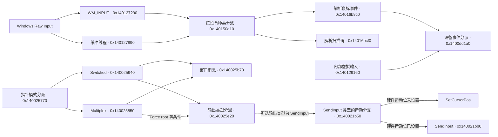

# MouseMux V3 x64 输入调用图

该图描述 [3.0.19 样本](../../docs/REVERSE_ENGINEERING.md)的静态调用关系。地址是模块的首选 VA，跨路径边只表示分支存在。图中省略部分中间函数。

输入解析到指针路由之间的完整调度链尚未确认。独立的键盘硬件路径为 `0x140008550` → `0x14000ec10` → `0x14000f930` → `SendInput`。代码点和证据 ID 见[发现记录](../../docs/MOUSEMUX_FINDINGS.md)。
